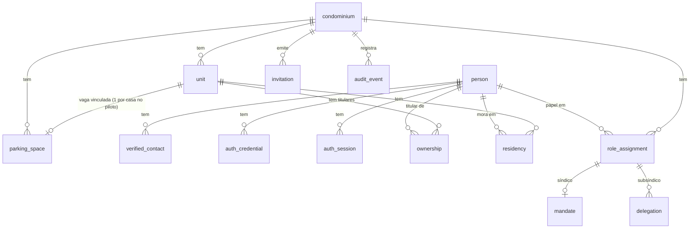

# Modelo de dados

Convenções (ADR-0004, ADR-0005): `id uuid` (v7); toda tabela de negócio com `condominium_id` e único `(condominium_id, id)`; chaves estrangeiras **compostas** entre tabelas de negócio; `created_at`/`updated_at` em `timestamptz`; `version int` para controle otimista; dinheiro em centavos `bigint`; medidas `numeric` com unidade.

## F1.1 — Identidade, condomínio e vínculos

| Tabela | Campos principais | Invariantes |
|---|---|---|
| `condominium` | nome, cidade, UF, fuso (`America/Sao_Paulo`), idiomas, `environment` (`demo`/`sandbox`/`production`) | dado de demonstração só em condomínio `demo` |
| `unit` | rótulo provisório, número oficial (pendente), quartos, situação | (condomínio, rótulo) único |
| `parking_space` | número, unidade vinculada, acessibilidade, croqui | uma vaga por unidade no piloto; vaga de um condomínio só liga à unidade do mesmo |
| `person` | nome, idioma preferido | global (pode estar em vários condomínios) |
| `verified_contact` | tipo (`email`/`phone`), valor normalizado (E.164), verificado em | (tipo, valor) único; telefone reciclado não herda vínculo |
| `auth_credential` | tipo (`password`/`totp`/`passkey`), hash/segredo cifrado | senha só em argon2id |
| `auth_session` | transporte (`web`/`native`), hash do token, CSRF, família de refresh, MFA em, expira, revogada | token nunca guardado em claro |
| `ownership` | unidade, pessoa, fração/participação (pendente), início, fim, situação (`pendente`/`validada`/`recusada`/`encerrada`), quem validou | fim > início; troca de titularidade encerra a anterior, sem apagar |
| `residency` | unidade, pessoa, início, fim, situação | não herda finanças nem segredos do proprietário |
| `role_assignment` | pessoa, papel, escopos, início, fim, situação | negar por padrão fora do período |
| `mandate` | papel síndico: início, fim, ata (documento), situação | não prorroga sozinho; vencido = sem gestão |
| `delegation` | de quem, para quem, ações, início, fim, documento | subsíndico só com delegação |
| `invitation` | finalidade, papel/vínculo proposto, hash do token, validade, tentativas, usado em | uso único, tentativas limitadas |
| `audit_event` | ator, papel, ação, objeto, resultado, motivo, `correlation_id`, horário do servidor | só acréscimo (sem `UPDATE`/`DELETE` pelo papel de aplicação) |

As demais entidades da especificação (§5) entram aqui no incremento que as implementa.
